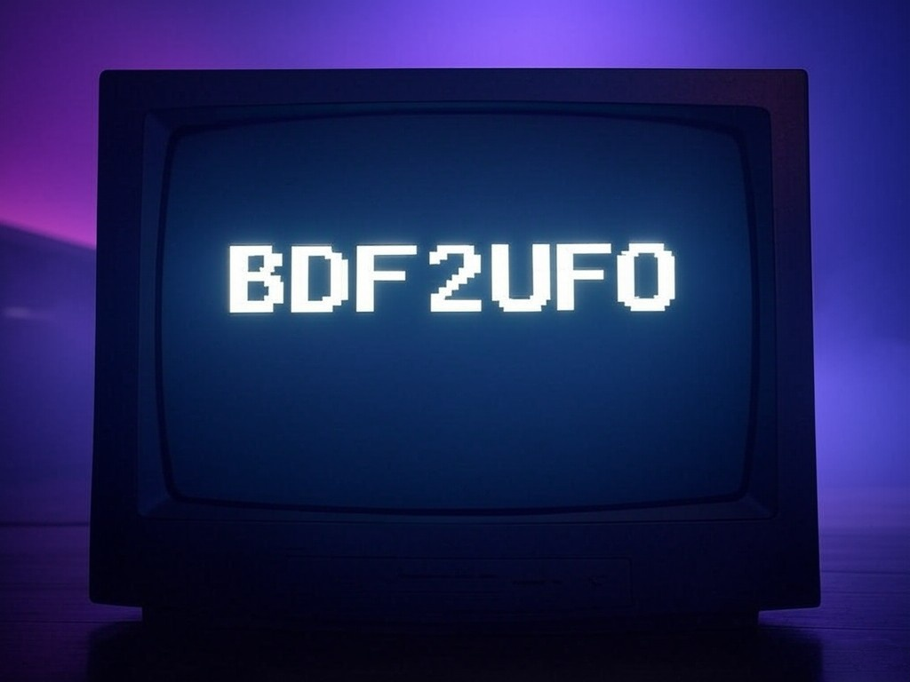
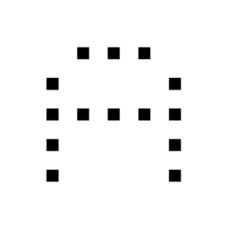
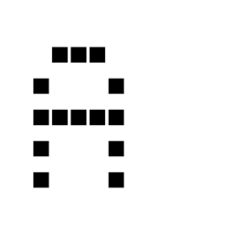
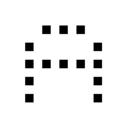
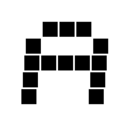
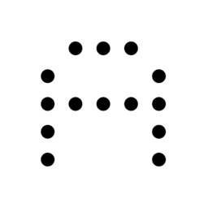
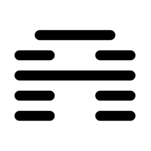
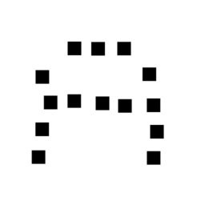

# bdf2ufo

**bdf2ufo** is a tool for converting `.bdf` bitmap fonts into `.ufo` sources, enabling the creation of both **static** and **variable** vector fonts.

It bridges the gap between classic pixel-based design and modern font production workflows—making it easy to bring legacy bitmap fonts into contemporary type systems.

## Features

### Variable Font Axes

bdf2ufo provides built-in support for six expressive axes tailored to pixel typography:

* **Weight (`wght`)**
* **Width (`wdth`)**
* **Italic (`ital`)**
* **Roundness (`ROND`)**
* **Bleed (`BLED`)**
* **Jitter (`JITT`)**

These axes allow you to simulate the rendering quirks of historical display technologies such as **LCD screens**, **CRT monitors**, and **dot matrix printers**, while remaining fully compatible with modern OpenType variable font workflows.

The `ital` axis slants the glyphs by the angle set with the `italic_angle` build configuration option (12 degrees by default).

The pixel element size follows the design coordinate of the `wght` axis: an element fills its pixel at 400, half of it at 200 and 1.75 times it at 700. The `axis_maps` build configuration option maps user coordinates to design coordinates on any axis, for example to make **Bold** (700) lighter and move the heaviest weight to **Black** (900). On an axis that is not variable, the map gives the design coordinate of its default value: a static font can report weight 400 or 700 while its elements keep the size of design weight 320. All other axis values in the build configuration are user coordinates.

### Smart Glyph Construction

* **Element Glyph System**

  Reuses a base “element” glyph to construct characters efficiently, reducing file size and complexity.

* **Automatic Composition**

  Builds precomposed characters (e.g. `é`) from their base and mark glyphs using Unicode decomposition data, and keeps the drawn glyph whenever its bitmap differs.

* **Anchor Generation**

  Automatically adds:

  * base-to-mark anchors
  * mark-to-mark anchors

* **Hinting-Safe Components**

  Flattens nested components and disables TrueType grid rounding of component offsets, so fonts rendered with hinting (e.g. on Windows) don't show empty pixel rows or columns.

* **Named Glyphs**

  Keeps unencoded glyphs (`ENCODING -1` in the `.bdf` file) under their BDF glyph name, without a Unicode value, if they are small caps (`.sc`), alternates (`.zero`) or, with the `ligatures` option, ligatures (`.liga`), run pieces (`.seq`) and numeric forms (`.num`). Other unencoded glyphs are left out, since no feature would reach them.

* **Small Caps**

  Generates the `smcp` and `c2sc` OpenType features for Latin and Cyrillic from the glyphs present in the font. See [Small caps](#small-caps).

* **Ligatures**

  Generates a `calt` feature for ligatures such as `!=` or `<|>` from `.liga` glyphs, arrows and lines of any length such as `-->` or `<====>` from `.seq` pieces, and forms such as the `×` of `1920x1080` from `.num` glyphs, keeping monospace fonts monospace. See [Ligatures](#ligatures).

* **Slashed Zero**

  Generates the `zero` feature from a `zero.zero` glyph. See [Slashed zero](#slashed-zero).

## Small caps

bdf2ufo writes `smcp` (lowercase to small caps) and `c2sc` (capitals to small caps) automatically for each script whose alphabet is complete. There is no option to set: a script only gets substitutions when every letter of its basic alphabet (a–z for Latin, а–я without й for Cyrillic) has a small cap, so a font with only a few small capitals, such as IPA `ɪ` and `ʀ`, gets no half-working feature.

The small cap of a lowercase letter is, in order of preference:

1. **A named glyph** with the letter's glyph name and a `.sc` suffix, such as `x.sc` or `uni0431.sc`. Glyph names are AGL names (`a`, `eacute`, `oslash`) or `uniXXXX`. A named glyph always wins, so it can replace any of the following.
2. **An existing glyph:**
   * the lowercase letter itself, if it is drawn as a small cap: most Cyrillic letters (в г д …), Latin letters such as ø ŋ ə, and the Unicode small capitals (ʀ ɪ). See `SMALL_CAPS_LOWERCASE` in `data.py`;
   * the Unicode small capital of the letter, found by name: `LATIN SMALL LETTER A` takes `LATIN LETTER SMALL CAPITAL A` (U+1D00 ᴀ), `LATIN SMALL LIGATURE OE` takes U+0276 ɶ;
   * the small cap of an alias, for letters without a small capital of their own, such as dotless ı (i) or kra ĸ (k). See `SMALL_CAPS_ALIASES` in `data.py`.
3. **The accented letter itself**, when its base letter is its own small cap (Cyrillic `й` on `и`).
4. **A built glyph** for any other accented letter, named after it with a `.sc` suffix (such as `aacute.sc`). Its accents are taken from its capital, but never placed like the capital places them:
   * If the capital is composed (for instance `Ǻ` from `A`, ring and acute), the small cap is composed from the same marks. Each mark attaches with its mark anchor to the anchor of the small cap, or of the previous mark of the same anchor, like on a lowercase letter. Where the capital draws its marks is not used.
   * If the capital is drawn, its accent pixels are copied and moved onto the small cap of the base letter by the difference of their base anchors, so an accent drawn differently from the combining mark (such as the apostrophe of `Ľ`) stays that way.
   * If the font has no such capital, the marks of the canonical decomposition are attached with their mark anchors.

A letter that is its own small cap is substituted by a `.sc` copy of itself, so that `smcp` and `c2sc` change the glyph, as Shaperglot expects.

A Cyrillic font thus only needs `.sc` glyphs for а б е р у ф to get Cyrillic small caps. Small caps are never taken from another script, so Latin small caps are not reused for Cyrillic letters.

Lowercase letters need an uppercase form to get a small cap, so IPA letters such as `ɹ` or `ʎ` keep their shape. Greek is not supported yet.

The substitutions of each script are written as separate lookups: Latin applies to the `DFLT` and `latn` scripts, Cyrillic to `cyrl`. A glyph that the `ccmp` feature substitutes for a letter of another script (`i` for the Cyrillic `і`) thus takes the small cap of the script of the text.

### Anchors for accented small caps

bdf2ufo assumes no anchors for small caps: a small cap only has the anchors that `custom_anchors` gives it, keyed by character or by glyph name. A letter that is its own small cap, such as `ø`, keeps its own anchors, and so does its `.sc` copy. Accented small caps are placed on these anchors, so a small cap needs the anchors that its accents attach to:

```yaml
custom_anchors:
  "ᴀ": # Small capital a
    "top": [2, 5]
    "bottom": [2, -1]
    "ogonek": [3, 0]
  "x.sc": # Small capital x
    "top": [2, 5]
    "bottom": [2, -1]
```

The same anchors also position combining marks typed after a small cap.

bdf2ufo warns about every small cap that lacks an anchor that its capital has, naming the missing anchors:

```text
uni025B.sc has no 'bottom', 'ogonek', 'top' anchor, which uni0190 has
```

An accented small cap whose base small cap lacks the anchor of one of its accents is not built, and bdf2ufo warns about it:

```text
uni1E13.sc could be built with a 'bottom' anchor on uni1D05
```

Run bdf2ufo with `-v` to see in the build log what else is missing, for instance:

```text
Small caps (cyrl) left out, 6 of 31 letters have no small cap: а б е р у ф
U+0431 has no small cap, uni0431.sc could be added
uni0451.sc could be built with a small cap of uni0415
```

## Ligatures

A ligature is an unencoded glyph named after the glyph names of its characters, joined by underscores, with a `.liga` suffix: `exclam_equal.liga` for `!=`, `exclam_equal_equal.liga` for `!==`, `less_exclam_hyphen_hyphen.liga` for `<!--`. Glyph names are AGL names (`hyphen`, `less`, `equal`, `bar`, `period`) or `uniXXXX`. Draw the ligature as wide as its characters together; in a monospace font, that is one cell per character (advance 12 for two characters in a font with `monospace: 6`).

Ligatures, runs and numeric forms are off by default, so one `.bdf` file can build a font with and one without them. Turn them on in the build configuration:

```yaml
ligatures: true
```

bdf2ufo writes the substitutions into the `calt` feature, which editors and terminals with ligature support turn on:

* **Monospace fonts:** a ligature of n characters becomes n glyphs one cell wide: n − 1 empty spacer glyphs (`LIG`), followed by the ligature glyph, whose drawing reaches back over the spacers. Every glyph keeps the monospace advance, so the font stays monospace (`isFixedPitch`, Panose, `advanceWidthMax`), columns stay aligned and the cursor still moves one cell at a time. A ligature whose advance is not a whole number of cells is left out with a warning.
* **Proportional fonts:** the characters are replaced by the ligature glyph, with the advance it is drawn with.

A ligature only forms where the character before or after it does not continue it: not where its first or last character repeats (`++` forms in `i++;`, but not in `++++`), and not where it is part of a longer run, see below (`<=` forms in `a <= b`, `a<=-1` and `-<=`, but `<==` and `<=>` are runs, and so are the `<<` of `<<-` and the `!=` of `=!=`). A run that would only take a head character of a ligature does not stop it: `|>` forms in `|>-`, and `!=` in `!=>`. Longer ligatures are tried first, and of the same length, `||`, `>>`, `<<` and `<|` before the others, as in Fira Code (`LIGATURE_FIRST` in `data.py`): `<|` takes the `<` of `--<|` before `--` checks for a run, so `--` stays a ligature there.

A ligature drawn like its characters keeps them from forming a run or another ligature, such as a `greater_equal_less.liga` drawn as `>=<`, which Fira Code leaves as typed. A ligature can also be drawn as the shapes another font shows for its characters, such as a `less_less_plus_greater.liga` drawn as `<` and the `<+>` ligature.

### Runs

A run is a line of any length, such as `--`, `---->`, `<==>`, `|->`, `####` or `___`. Each of its characters becomes a piece one cell wide, so a monospace font only needs a few pieces for every length. A piece is an unencoded glyph with a `.seq` suffix, named after the glyph names of the characters it stands for, the line character and its role, joined by underscores:

| Piece | Stands for | Example |
|---|---|---|
| `hyphen_start.seq` | the first `-` of a run | `-` of `-->` |
| `hyphen_middle.seq` | a `-` inside a run | `-` of `<-->` |
| `hyphen_end.seq` | the last `-` of a run | `-` of `<--` |
| `less_hyphen_start.seq` | a head before the line | `<` of `<--` |
| `greater_hyphen_end.seq` | a head after the line | `>` of `-->` |
| `less_less_hyphen_start.seq` | a head of two characters, drawn two cells wide | `<<` of `<<-` |
| `less_equal_equal_end.seq` | a head after a line of at least two cells: two line characters, or a head and a line character | `<` of `==<` and `<=<`, but not of `a=<b` |
| `bar_equal_equal_start.seq` | a head before a line of at least two cells: two line characters, or a line character and what may continue it | `\|` of `\|==` and `\|=>`, but not of `a\|=b` |
| `bar_hyphen_middle.seq` | a head between two lines, joining both | middle `\|` of `\|---\|---\|`, `>` of `->-` (`greater_hyphen_middle.seq`), `!` of `==!==` (`exclam_equal_middle.seq`) |

A line character needs all three of its start, middle and end pieces; heads are optional. A head between two lines of the same character takes its middle piece if the font has one, so it joins both sides (`->-`, `==/==`). A head between two different lines joins the `=` line before the `-` line, and otherwise the line before it, as in Fira Code: the `>` of `-->==` starts `>==`, and the `>` of `==>--` and `=>-` ends the arrow (`SEQUENCE_LINE_ORDER` in `data.py`). A run forms wherever a line character is next to another one, or to one of its heads, after the ligatures, so a ligature that is a whole operator, such as `<=`, `==` or `>>=`, wins over a run. Runs need a monospace font.

### Numeric forms

A numeric form is an unencoded glyph with a `.num` suffix, such as `x.num` or `colon.num`. It replaces its character between two digits, or between `0` and a hexadecimal letter: the `×` of `1920x1080` and `0xFF`, the centered colon of `10:30`.

### Checking the rules

`scripts/bdf2ufo/calt.py` reads the rules from the glyph names and only needs the Python standard library. Its `CaltRules.shape()` shapes a line of text the way the generated `calt` feature does, step by step, so a specimen or a test can set text without a text shaper.

The glyphs of the `calt` feature are added after all other glyphs, so the `JITT` axis jitters the other glyphs the same way with or without ligatures.

## Slashed zero

Draw the slashed (or dotted) zero as an unencoded glyph named `zero.zero`, the glyph name of `0` with the feature tag as suffix. bdf2ufo writes the `zero` feature, which apps turn on to tell `0` from `O`:

```fea
feature zero {
    sub zero by zero.zero;
} zero;
```

In a monospace font, the alternate must have the monospace advance, or it is left out with a warning. The `zero` feature needs no build configuration option, and it is off until an app turns it on, so `0` keeps its default form. Like ligatures, alternates are added after all other glyphs.

## Axes overview

| Tag  | Name      | Small                                    | Large                                    |
| ---- | --------- | ---------------------------------------- | ---------------------------------------- |
| wght | Weight    |  |  |
| wdth | Width     |   |  |
| ital | Italic    |    |    |
| ROND | Roundness |    |  |
| BLED | Bleed     |    |  |
| JITT | Jitter    |    |  |

## Getting Started

### 1. Convert your source font (if needed)

If your font is in `.ttf` or `.otf`, convert it to `.bdf` using `otf2bdf`:

* **macOS (Homebrew)**

  ```bash
  brew install otf2bdf
  ```

* **Ubuntu**

  ```bash
  sudo apt install otf2bdf
  ```

* **Windows**
  Download from: [http://sofia.nmsu.edu/~mleisher/Software/otf2bdf/](http://sofia.nmsu.edu/~mleisher/Software/otf2bdf/)

### 2. Set up your environment

Make sure you have:

* Python
* pip

Install dependencies:

```bash
pip install -r requirements.txt
```

### 3. Prepare your project

* Create an empty directory for your `.ufo` masters
* Review the example config:
  `sources/PressStart2P/PressStart2P-build-config.yaml`

### 4. Run bdf2ufo

View CLI usage:

```bash
python -m scripts.bdf2ufo.cli
```

bdf2ufo only prints warnings and errors. Add `-v` (`--verbose`) to log the progress of the conversion, including which small caps could be added.

bdf2ufo builds the masters in parallel, one process per CPU it may run on (which `taskset` or a container can limit). `-j` (`--jobs`) sets the number of processes; `-j 1` builds them one after the other. The masters are the same either way.

`-c` (`--config`) can be given more than once. The options of each file replace those of the files before it, so a second font can share the configuration of the first one and change only a few options:

```bash
python -m scripts.bdf2ufo.cli -c sources/MyFont-build-config.yaml -c sources/MyFontCode-build-config.yaml sources/MyFont.bdf sources
```

```yaml
# MyFontCode-build-config.yaml
family_name: "My Font Code"
ligatures: true
```

Each top-level option is replaced as a whole: a `custom_anchors` or `variable_instances` in a later file replaces the earlier one entirely.

### 5. Build your fonts

Create a `config.yaml` in your masters directory:

```yaml
sources:
  - [font-name].designspace
autohintTTF: false
flattenComponents: false
```

Both options matter for pixel fonts:

* `autohintTTF: false` keeps ttfautohint away from the static fonts. gftools then adds a `gasp` table and a `prep` program with dropout control instead, and the outlines stay on the pixel grid.
* `flattenComponents: false` keeps the components of static fonts as bdf2ufo wrote them. If gftools builder flattens them, they lose the setting that turns off grid rounding, and hinted rendering shows empty pixel rows and columns.

See `sources/config.yaml` for an example.

Then compile using:

```bash
gftools builder [masters-path]/config.yaml
```

## Fonts using bdf2ufo

* **Tiny5**
  [https://github.com/Gissio/font_Tiny5](https://github.com/Gissio/font_Tiny5)

* **DotMatrix**
  [https://github.com/Gissio/font_DotMatrix](https://github.com/Gissio/font_DotMatrix)

## Additional Resources

* **Bits'N'Picas** – Bitmap font editor
  [https://github.com/kreativekorp/bitsnpicas](https://github.com/kreativekorp/bitsnpicas)

* **FontDrop!** – Online font inspector
  [https://fontdrop.info/](https://fontdrop.info/)

* **Fontspector** – Visual font QA and reporting tool
  [https://fonttools.github.io/fontspector/](https://fonttools.github.io/fontspector/)

* **The Font Testing Page** – Browser-based font testing
  [https://www.impallari.com/testing/](https://www.impallari.com/testing/)

* **Shaperglot** – Language support checker
  [https://googlefonts.github.io/shaperglot/](https://googlefonts.github.io/shaperglot/)

* **Hyperglot** – Language support checker
  [https://hyperglot.rosettatype.com/](https://hyperglot.rosettatype.com/)

* **What Unicode character is this?** – Identify Unicode characters by symbol, code point, or name
  [https://www.babelstone.co.uk/Unicode/whatisit.html](https://www.babelstone.co.uk/Unicode/whatisit.html)

* **SYMBL** – Unicode character reference
  [https://symbl.cc/](https://symbl.cc/)

* **Combining characters** – Easy access to combining Unicode marks
  [https://sheeptester.github.io/javascripts/combining.html](https://sheeptester.github.io/javascripts/combining.html)
  