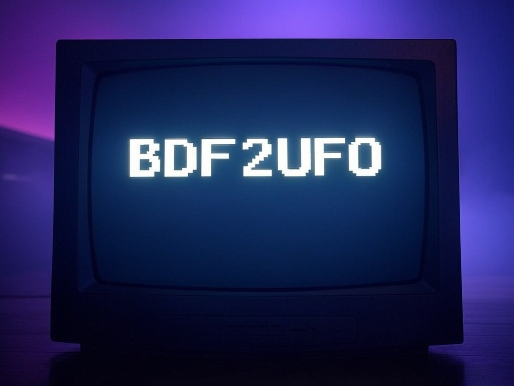
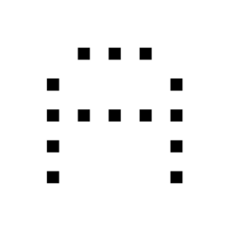
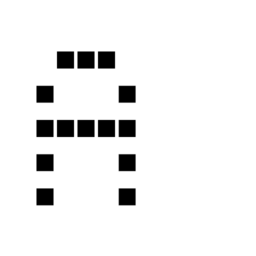
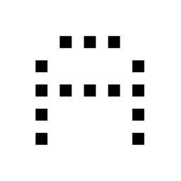
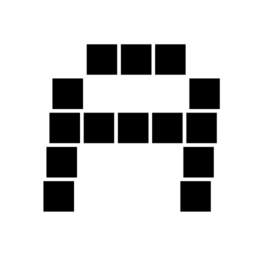
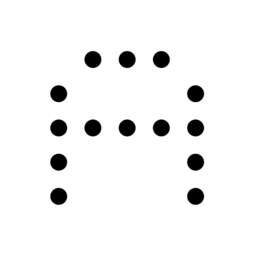
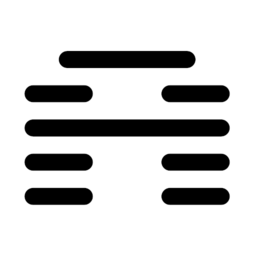
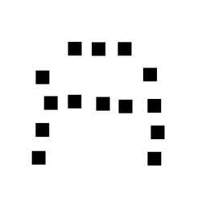

# bdf2ufo

**bdf2ufo** is a tool for converting `.bdf` bitmap fonts into `.ufo` sources, enabling the creation of both **static** and **variable** vector fonts.

It bridges the gap between classic pixel-based design and modern font production workflows—making it easy to bring legacy bitmap fonts into contemporary type systems.

## Features

### Variable Font Axes

bdf2ufo provides built-in support for six expressive axes tailored to pixel typography:

* **Weight (`wght`)**
* **Width (`wdth`)**
* **Italic (`ital`)**
* **Roundness (`ROND`)**
* **Bleed (`BLED`)**
* **Jitter (`JITT`)**

These axes allow you to simulate the rendering quirks of historical display technologies such as **LCD screens**, **CRT monitors**, and **dot matrix printers**, while remaining fully compatible with modern OpenType variable font workflows.

The `ital` axis slants the glyphs by the angle set with the `italic_angle` build configuration option (12 degrees by default).

The pixel element size follows the design coordinate of the `wght` axis: an element fills its pixel at 400, half of it at 200 and 1.75 times it at 700. The `axis_maps` build configuration option maps user coordinates to design coordinates on any axis, for example to make **Bold** (700) lighter and move the heaviest weight to **Black** (900). All other axis values in the build configuration are user coordinates.

### Smart Glyph Construction

* **Element Glyph System**

  Reuses a base “element” glyph to construct characters efficiently, reducing file size and complexity.

* **Automatic Composition**

  Builds precomposed characters (e.g. `é`) from their base and mark glyphs using Unicode decomposition data, and keeps the drawn glyph whenever its bitmap differs.

* **Anchor Generation**

  Automatically adds:

  * base-to-mark anchors
  * mark-to-mark anchors

* **Hinting-Safe Components**

  Flattens nested components and disables TrueType grid rounding of component offsets, so fonts rendered with hinting (e.g. on Windows) don't show empty pixel rows or columns.

* **Named Glyphs**

  Keeps unencoded glyphs (`ENCODING -1` in the `.bdf` file) under their BDF glyph name, without a Unicode value.

* **Small Caps**

  Generates the `smcp` and `c2sc` OpenType features for Latin and Cyrillic from the glyphs present in the font. See [Small caps](#small-caps).

## Small caps

bdf2ufo writes `smcp` (lowercase to small caps) and `c2sc` (capitals to small caps) automatically for each script whose alphabet is complete. There is no option to set: a script only gets substitutions when every letter of its basic alphabet (a–z for Latin, а–я without й for Cyrillic) has a small cap, so a font with only a few small capitals, such as IPA `ɪ` and `ʀ`, gets no half-working feature.

The small cap of a lowercase letter is, in order of preference:

1. **A named glyph** with the letter's glyph name and a `.sc` suffix, such as `x.sc` or `uni0431.sc`. Glyph names are AGL names (`a`, `eacute`, `oslash`) or `uniXXXX`. A named glyph always wins, so it can replace any of the following.
2. **An existing glyph:**
   * the lowercase letter itself, if it is drawn as a small cap: most Cyrillic letters (в г д …), Latin letters such as ø ŋ ə, and the Unicode small capitals (ʀ ɪ). See `SMALL_CAPS_LOWERCASE` in `data.py`;
   * the Unicode small capital of the letter, found by name: `LATIN SMALL LETTER A` takes `LATIN LETTER SMALL CAPITAL A` (U+1D00 ᴀ), `LATIN SMALL LIGATURE OE` takes U+0276 ɶ;
   * the small cap of an alias, for letters without a small capital of their own, such as dotless ı (i) or kra ĸ (k). See `SMALL_CAPS_ALIASES` in `data.py`.
3. **The accented letter itself**, when its base letter is its own small cap (Cyrillic `й` on `и`).
4. **A built glyph** for any other accented letter, named after it with a `.sc` suffix (such as `aacute.sc`). Its accents are taken from its capital and moved onto the small cap of the base letter by the difference of their base anchors, such as `top`. An accent above that the capital draws off its anchor, such as an acute centred on a four pixel wide capital, is placed on the anchor of the small cap, like on a lowercase letter:
   * If the capital is composed (for instance `Ǻ` from `A`, ring and acute), the small cap is composed from the same marks, so stacked accents keep the spacing of the capital.
   * If the capital is drawn, its accent pixels are copied, so an accent drawn differently from the combining mark (such as the apostrophe of `Ľ`) stays that way.
   * If the font has no such capital, the marks of the canonical decomposition are attached with their mark anchors.

A letter that is its own small cap is substituted by a `.sc` copy of itself, so that `smcp` and `c2sc` change the glyph, as Shaperglot expects.

A Cyrillic font thus only needs `.sc` glyphs for а б е р у ф to get Cyrillic small caps. Small caps are never taken from another script, so Latin small caps are not reused for Cyrillic letters.

Lowercase letters need an uppercase form to get a small cap, so IPA letters such as `ɹ` or `ʎ` keep their shape. Greek is not supported yet.

The substitutions of each script are written as separate lookups: Latin applies to the `DFLT` and `latn` scripts, Cyrillic to `cyrl`. A glyph that the `ccmp` feature substitutes for a letter of another script (`i` for the Cyrillic `і`) thus takes the small cap of the script of the text.

### Anchors for accented small caps

bdf2ufo assumes no anchors for small caps: a small cap only has the anchors that `custom_anchors` gives it, keyed by character or by glyph name. A letter that is its own small cap, such as `ø`, keeps its own anchors, and so does its `.sc` copy. bdf2ufo warns about every small cap that lacks an anchor that its capital has, and accented small caps are only built when both the small cap and the capital base have the anchor that places the accent:

```yaml
custom_anchors:
  "ᴀ": # Small capital a
    "top": [2, 5]
    "bottom": [2, -1]
    "ogonek": [3, 0]
  "x.sc": # Small capital x
    "top": [2, 5]
    "bottom": [2, -1]
```

The same anchors also position combining marks typed after a small cap.

The warning names the missing anchors:

```text
uni025B.sc has no 'bottom', 'ogonek', 'top' anchor, which uni0190 has
```

Run bdf2ufo with `-v` to see in the build log what else is missing, for instance:

```text
Small caps (cyrl) left out, 6 of 31 letters have no small cap: а б е р у ф
U+0431 has no small cap, uni0431.sc could be added
uni0451.sc could be built with a small cap of uni0415
uhorn.sc could be built with a 'horn' anchor on uni1D1C
```

## Axes overview

| Tag  | Name      | Small                                    | Large                                    |
| ---- | --------- | ---------------------------------------- | ---------------------------------------- |
| wght | Weight    |  |  |
| wdth | Width     |   |  |
| ital | Italic    |    |    |
| ROND | Roundness |    |  |
| BLED | Bleed     |    |  |
| JITT | Jitter    |    |  |

## Getting Started

### 1. Convert your source font (if needed)

If your font is in `.ttf` or `.otf`, convert it to `.bdf` using `otf2bdf`:

* **macOS (Homebrew)**

  ```bash
  brew install otf2bdf
  ```

* **Ubuntu**

  ```bash
  sudo apt install otf2bdf
  ```

* **Windows**
  Download from: [http://sofia.nmsu.edu/~mleisher/Software/otf2bdf/](http://sofia.nmsu.edu/~mleisher/Software/otf2bdf/)

### 2. Set up your environment

Make sure you have:

* Python
* pip

Install dependencies:

```bash
pip install -r requirements.txt
```

### 3. Prepare your project

* Create an empty directory for your `.ufo` masters
* Review the example config:
  `sources/PressStart2P/PressStart2P-build-config.yaml`

### 4. Run bdf2ufo

View CLI usage:

```bash
python -m scripts.bdf2ufo.cli
```

bdf2ufo only prints warnings and errors. Add `-v` (`--verbose`) to log the progress of the conversion, including which small caps could be added.

### 5. Build your fonts

Create a `config.yaml` in your masters directory:

```yaml
sources:
  - [font-name].designspace
autohintTTF: false
flattenComponents: false
```

Both options matter for pixel fonts:

* `autohintTTF: false` keeps ttfautohint away from the static fonts. gftools then adds a `gasp` table and a `prep` program with dropout control instead, and the outlines stay on the pixel grid.
* `flattenComponents: false` keeps the components of static fonts as bdf2ufo wrote them. If gftools builder flattens them, they lose the setting that turns off grid rounding, and hinted rendering shows empty pixel rows and columns.

See `sources/config.yaml` for an example.

Then compile using:

```bash
gftools builder [masters-path]/config.yaml
```

## Fonts using bdf2ufo

* **Tiny5**
  [https://github.com/Gissio/font_Tiny5](https://github.com/Gissio/font_Tiny5)

* **DotMatrix**
  [https://github.com/Gissio/font_DotMatrix](https://github.com/Gissio/font_DotMatrix)

## Additional Resources

* **Bits'N'Picas** – Bitmap font editor
  [https://github.com/kreativekorp/bitsnpicas](https://github.com/kreativekorp/bitsnpicas)

* **FontDrop!** – Online font inspector
  [https://fontdrop.info/](https://fontdrop.info/)

* **Fontspector** – Visual font QA and reporting tool
  [https://fonttools.github.io/fontspector/](https://fonttools.github.io/fontspector/)

* **The Font Testing Page** – Browser-based font testing
  [https://www.impallari.com/testing/](https://www.impallari.com/testing/)

* **Shaperglot** – Language support checker
  [https://googlefonts.github.io/shaperglot/](https://googlefonts.github.io/shaperglot/)

* **Hyperglot** – Language support checker
  [https://hyperglot.rosettatype.com/](https://hyperglot.rosettatype.com/)

* **What Unicode character is this?** – Identify Unicode characters by symbol, code point, or name
  [https://www.babelstone.co.uk/Unicode/whatisit.html](https://www.babelstone.co.uk/Unicode/whatisit.html)

* **SYMBL** – Unicode character reference
  [https://symbl.cc/](https://symbl.cc/)

* **Combining characters** – Easy access to combining Unicode marks
  [https://sheeptester.github.io/javascripts/combining.html](https://sheeptester.github.io/javascripts/combining.html)
  